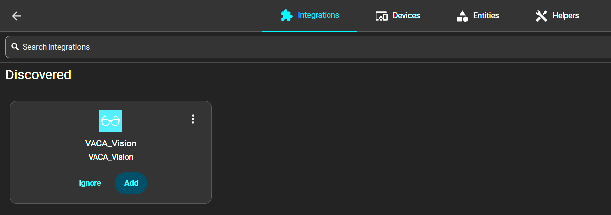
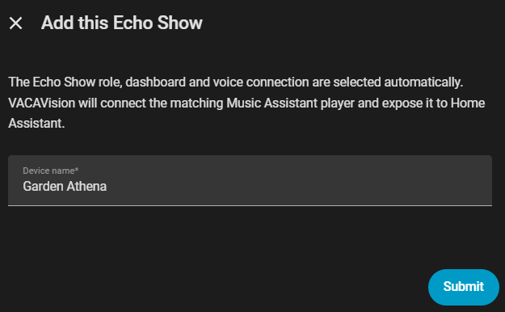
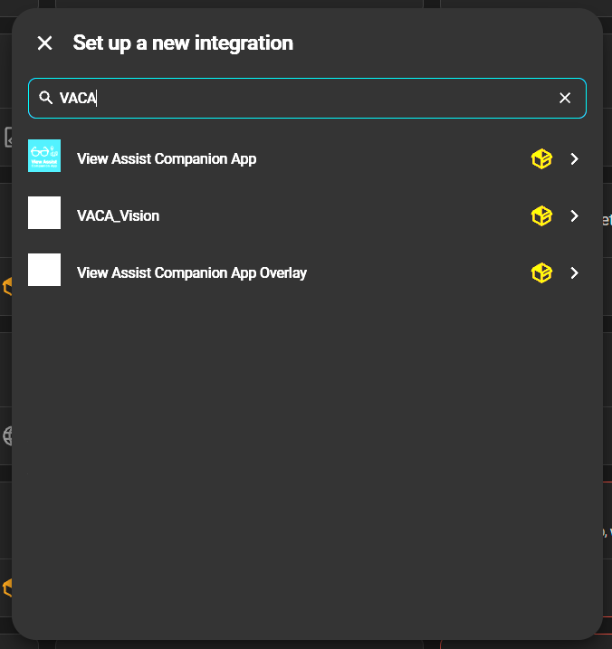
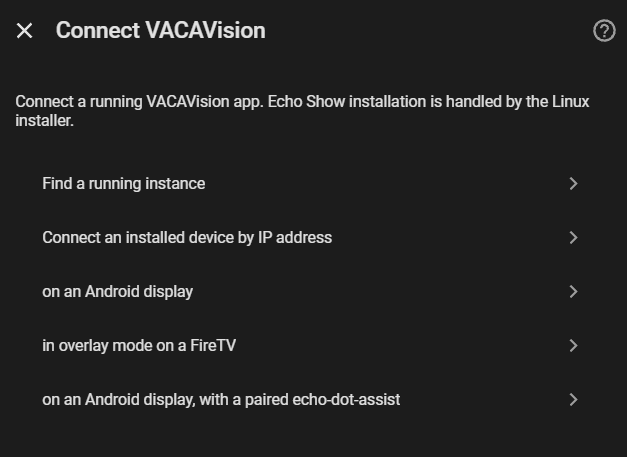
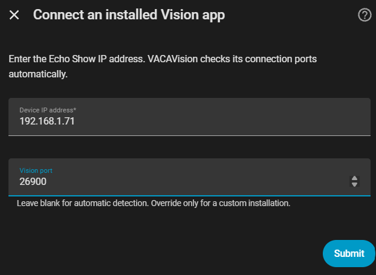
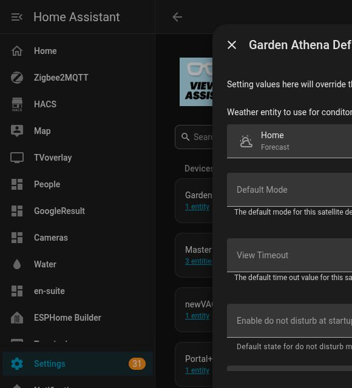

# VACAVision

VACAVision connects an Android display to Home Assistant and View Assist. On an Echo Show 8 Gen 2, Echo Dot Assist supplies Amazon wake-word detection, audio processing, Assist audio and Sendspin playback; VACAVision supplies the display companion and HA integration.

## One APK for every display mode

Version `0.3.0-unified-preview.3` (22), bundled with integration `0.6.2`, includes
both the ES8/standard display and the original Fire TV overlay implementation.
Install `custom_components/vaca_vision/packages/vacav.apk` on either device.
The picker and remote setup launchers are included; no second picker APK is needed.

The Home Assistant installer and Windows installer select `overlay` for Fire TV,
including Fire TV paired with an Echo Dot. The ES8 installer selects `standard`.
On an unconfigured install, Amazon AFT models default to overlay; other devices
default to standard. The choice persists across restarts. The active mode advertises
its compatible roles to HA, and only that mode's display/connection service runs.

For manual installation, grant the device's existing permissions and select its mode:

```sh
adb -s DEVICE install -r custom_components/vaca_vision/packages/vacav.apk
adb -s DEVICE shell am start -n com.mph1970.vacavision/com.msp1974.vacompanion.MainActivity --es vacav_mode standard
# Use --es vacav_mode overlay on Fire TV.
```

Windows: `tools/setup-device.ps1 -Platform overlay -Serial 192.168.1.169:5555 -ApkPath custom_components/vaca_vision/packages/vacav.apk`.
The same script accepts `-Platform standard`. Installers never uninstall an app
on a signature mismatch. Older Fire TV installations need an explicitly chosen
migration; retain their configuration privately before uninstalling.

The ES8's native Echo Dot Assist audio ownership, dashboard, streaming controls,
and double-tap Home popup are retained. Fire TV retains transparent dashboards,
picker profiles, remote controls, alarm popups, paired-Echo replies and Sendspin.

Build from `app/standard` with the Gradle wrapper. Set `VACAV_SIGNING_KEYSTORE`
to the private external Linux debug keystore before building an update. Neither
the key nor device backups belong in this repository. Tests use a Java 21 toolchain:

```sh
./gradlew :app:assembleDebug :app:testDebugUnitTest --no-watch-fs
```

See [unified-mode validation](docs/UNIFIED-VALIDATION.md) for the tested behaviors.

## Install the Home Assistant integration with HACS

View Assist and Music Assistant, including its official Home Assistant integration, must already be operational for the Echo Show setup.

1. Open **HACS → ⋮ → Custom repositories**.
2. Add `https://github.com/baileyboy0304/VACAV` with type **Integration**.
3. Find **VACAVision**, download it and restart Home Assistant.
4. Install the Android app using your device installer. HACS installs the HA integration; it does not unlock the Echo or install the Android app.

For the Echo Show 8 Gen 2, follow the [ES8_Athena installer guide](https://github.com/baileyboy0304/ES8_Athena). That repository currently requires access from its owner. Unlocking and Echo Dot Assist installation are documented by [Echo Dot Assist, checkers branch](https://github.com/Gamer92000/echo-dot-assist/tree/checkers).

## Connect an installed Echo Show

Complete Music Assistant Sendspin pairing using the token on Echo Dot Assist’s
done-screen before adding this Echo. Note its player name for the View Assist
player selections below.

**1. Add the discovered device.** Open **Settings → Devices & services**.
Under **Discovered**, select **Add** on the **VACA_Vision** card.



If you already have VACA_Vision devices, you can also open the integration and
select **Add** on its **Discovered** row.


**2. Confirm the device name**, then select **Submit**. The Echo Show role,
dashboard and voice connection are selected automatically. VACAVision connects
the matching Music Assistant player and exposes it to Home Assistant.



<details>
<summary>If the Echo Show does not appear under Discovered</summary>

Check that VACAVision is running and HA can reach the Echo Show's IP address.
Select **Add integration**, search for `VACA`, and choose **VACA_Vision**.
If you already have the integration, open it and select **Add device**.



Choose **Connect an installed device by IP address**.



Enter the Echo Show's IP address printed by the installer and select **Submit**.
If **Vision port** is shown, leave it blank for automatic detection; only enter
a port for a custom installation. The screenshot shows the usual Echo Show port,
`26900`.



Confirm the device name and select **Submit**.


Continue with selecting the voice assistant below.

</details>

**3. Select the voice assistant.** Open the new device page and select its Assist
pipeline. Then sign into HA on the Echo Show touchscreen.

## Create the View Assist device

Open **Settings → Devices & services → View Assist → Add device**. Select
**View Assist device with display**, then **Next**.


Use the name entered in the Linux installer to find this Echo’s entities. The
following example uses **Garden Athena**; substitute your own device name.

| Field | What to enter or select | Garden Athena example |
|---|---|---|
| Satellite Name | The name entered in the installer | `Garden Athena` |
| Microphone device | The Assist satellite on this VACAVision device | `assist_satellite.garden_athena_assist` |
| Media player device | This Echo’s Music Assistant player | `media_player.echo_show_8_2nd_gen_a57772` |
| Music player device | The same Music Assistant player | `media_player.echo_show_8_2nd_gen_a57772` |
| Intent Device | Leave empty for this setup | Empty |
| Orientation Sensor | Leave empty for this setup | Empty |
| Display Device | The value of this VACAVision device’s **View Assist display device** sensor | `va-vision-a2ac0a84-4a88-4a5d-ae07-de5090a49ae8` |

To find the microphone and display ID, open **VACAVision → your device** in another
HA tab. Its entities include **Assist** and **View Assist display device**. Open the
display sensor and copy its value, then select that exact value in View Assist.

Music Assistant may name the player after the hardware, such as **Echo Show 8 2nd
gen a57772**. Match it to the name shown on Echo Dot Assist’s done-screen.
Use that Music Assistant player in both player fields.


The screenshot shows these fields under an existing device’s **Core Device
Configuration**. Use the same selections when adding the device.

Select **Submit**. Open the new View Assist device’s **Configure** menu:

- Under **Default Options**, set **Disable announce on this device** to **On**.
  Despite the label, **On** stores `use_announce: on` and enables announcements.
- Set **Volume ducking percentage** to **0**.
- Enable **Auto music mode** so View Assist opens the music view when playback starts.
- In the same **Default Options**, use your existing View Assist weather setting, such
  as `weather.home`, or select the weather entity for this display. View Assist
  applies its master settings when the device has no override.



## Install the example dashboards (optional)

Open **Settings → Devices & services → VACAVision → your device → Configure →
Install example dashboards**, then follow **Open the dashboard installer**.


Install the dashboards after creating the View Assist device. They use its sensor
entity and weather setting. The installer also checks its microphone, display and
Music Assistant player mappings before preparing the dashboards. It detects the Music Assistant page in HA.
If that page cannot be identified, open Music Assistant and copy the URL path after
the host and port into the requested field.


Select **Install example dashboards**, review the three destination names, then
select **Back up and install**. Existing dashboard configurations are backed up in
HA before replacement. The completion screen shows the backup location and the
View Assist dashboard paths.

Open **View Assist → your device → Configure → Dashboard Options** and enter
those paths. For a new install named **Garden Athena**, they are:

| View Assist setting | Path |
|---|---|
| Dashboard | `/view-assist-garden-athena` |
| Home | `/view-assist-garden-athena/clock` |
| Music | `/view-assist-garden-athena/music` |
| Intent | `/view-assist-garden-athena/intent` |
| List | `/view-assist-garden-athena/list` |

Resumed installations retain their saved dashboard names; use the paths shown on
the completion screen. VACAV’s startup page is set to the installed Home launcher.

The integration serves the dashboard assets. Install `custom:button-card` and the
View Assist frontend before installing the example dashboards.

Test voice and music on the Echo, then sign into your streaming services.

## Updating older Android builds

Prototype.12, prototype.13, and the unified APK use the same Linux signing certificate. The previously
bundled prototype.10 APK used a different certificate. Android cannot install this
APK over that build; the installer stops rather than deleting app data. An upgrade
needs the previous signing key or an explicitly chosen reinstall and HA browser
sign-in. Fresh installations can use the new APK directly.

## Source and acknowledgements

The integration is in `custom_components/vaca_vision/`, including its installation payloads. Android source is in `app/`.

This variant is based on [MSP1974's View Assist Companion App](https://github.com/msp1974/ViewAssistCompanionApp) and works with [Dinki's View Assist](https://github.com/dinki/View-Assist) ([documentation](https://dinki.github.io/View-Assist/)). Original authors do not maintain or endorse these variant-specific changes. See `LICENSE`, `NOTICE`, and the retained app/component licenses.

Run setup-flow tests with `pip install -r requirements-dev.txt` followed by `python -m unittest discover -s tests -v`.

## Floating streaming controls

**Double-tap the screen in a streaming app to open the popup**, then tap **Home**
to return to your dashboard. The popup also provides **Keep on** and **Brightness**
and works during playback and on sign-in/browsing screens.
The popup hides after five seconds. Taps also reach the streaming app, so its
player may respond to the gesture.

The built-in **VACA_Vision Picker** launcher retains the original picker icon and TV banner. When migrating from the separate picker helper, select the built-in picker in Sidekick (or another shortcut app), then remove the obsolete `com.mph1970.vacavision.pickercontrol` helper. Picker menus, layouts and profiles remain in the main VACAV app.

**VACA_Vision Remote** opens optional Bluetooth remote setup for a separate controller. The normal Fire TV remote can operate the picker without this setup. Local picker configuration remains available through the **Settings** cog.
